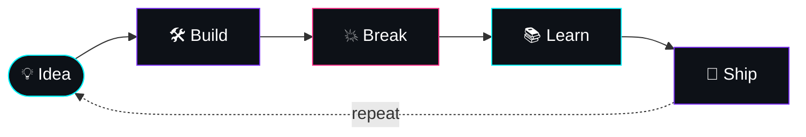

<!-- ═══════════════════ HEADER ═══════════════════ -->
<div align="center">


<br/>


</div>

<br/>

<!-- ═══════════════════ TERMINAL CARD ═══════════════════ -->
## `>_` whoami

```bash
swastik@heaven:~$ cat about.json
{
  "name"       : "Swastik",
  "degree"     : "B.Tech CSE (Cyber Security) · UEM Kolkata 🇮🇳",
  "role"       : "Vice Chairperson, Google Gemini Student Community (GGSC)",
  "mindset"    : "security-first · problem solver · ships fast",
  "focus"      : ["AI/ML", "Computer Vision", "Full-Stack", "Security"],
  "creative"   : ["Cinematography", "Photography", "Graphic Design"],
  "achievement": "Top 20 / 2000+ teams — Navommesh 2.0 Hackathon",
  "motto"      : "Build → Break → Learn → Repeat",
  "status"     : "🟢 open to internships, hackathon teams & cool ideas"
}

swastik@heaven:~$ _
```

> *The same eye that frames a shot decides how I design a UI. That's the edge.*

<br/>

<!-- ═══════════════════ TWO SIDES ═══════════════════ -->
<div align="center">

## ⚡ Two Sides · One Person · Zero Compromises

<table>
<tr>
<td align="center" width="50%">

### 👨‍💻 The Engineer
Builds secure, scalable systems<br/>
Thinks in logic & architecture<br/>
Breaks things to understand them<br/>
**→ clean code, fast ships**

</td>
<td align="center" width="50%">

### 🎬 The Creator
Frames stories through a lens<br/>
Thinks in light & composition<br/>
Turns raw footage into emotion<br/>
**→ every pixel intentional**

</td>
</tr>
</table>

</div>

<br/>



<br/>

<!-- ═══════════════════ TECH STACK ═══════════════════ -->
## 🧰 Tech Arsenal

<div align="center">


<br/><br/>

| | |
|:--|:--|
| **🧬 Languages** |    |
| **⚙️ Frameworks** |    |
| **🤖 AI / Security** |     |
| **🎬 Creative** |     |
| **🛠️ Tools** |    |

</div>

<br/>

<!-- ═══════════════════ PROJECTS ═══════════════════ -->
## Selected Work

<sub>Applied ML, IoT and security systems — each one evaluated honestly against a baseline.</sub>

<div align="center">


</div>

<br/>

### 01 &nbsp;·&nbsp; Aircraft Manufacturer Classification
<sub>`PyTorch` `Torchvision` `ResNet-18` `Transfer Learning` `FGVC-Aircraft`</sub>

| Problem | Approach | Outcome |
|:--|:--|:--|
| Fine-grained recognition of **30 aircraft manufacturers** on a heavily imbalanced dataset (733 Boeing training images vs. ~33 for the smallest classes). | Frozen-backbone baseline → **partial fine-tuning** (layer4 + classifier head). Test set touched exactly once. Benchmarked against a majority-class and a pixel-level logistic-regression baseline. | **76.4% test accuracy · 0.79 macro-F1**, vs. 22.0% for the majority baseline and 26.4% for pixel logistic regression. |

<br/>

### 02 &nbsp;·&nbsp; Kolkata AQI Forecasting &nbsp;[](https://github.com/heaven-swastik/AQI-prediction)
<sub>`Python` `scikit-learn` `XGBoost` `Time-series features`</sub>

| Problem | Approach | Outcome |
|:--|:--|:--|
| Predict **next-day AQI for Kolkata** from historical air-quality records. | Lag-based feature engineering; **chronological** train/test split (no leakage). Persistence baseline vs. Ridge, Random Forest and XGBoost, scored on MAE, RMSE and R². | **Ridge Regression won — MAE 14.26, R² 0.875.** A simple model beat the complex ones on this data. |

<br/>

### 03 &nbsp;·&nbsp; Smart AI Refrigerator — Predictive Freshness
<sub>`FastAPI` `React` `MobileNetV2` `Grad-CAM` `Fruits-360` &nbsp;·&nbsp; IEEE research context</sub>

| Problem | Approach | Outcome |
|:--|:--|:--|
| Estimate **fruit ripeness and remaining freshness** using vision plus an electronic nose — deliberately without NIR spectroscopy. | 12-class **MobileNetV2** on real Fruits-360 photos; ripeness via classical colour science and freshness via **Q10 decay** (kept interpretable on purpose); **Grad-CAM** explainability; hardware abstraction layer for future Raspberry Pi / sensor integration. | **99.7% validation accuracy** (classifier), served through a FastAPI + React glassmorphism UI. |

<br/>

### 04 &nbsp;·&nbsp; SUFIN — Smart Urban Flood Intelligence Network
<sub>`Arduino` `GSM` `Flutter` `Next.js` `TypeScript` `Recharts` &nbsp;·&nbsp; IEEE research project</sub>

| Problem | Approach | Outcome |
|:--|:--|:--|
| Early warning for **urban drain overflow** where connectivity is poor. | Arduino + GSM sensor nodes; a **Flutter Android gateway** relays readings over SMS; a Next.js / TypeScript dashboard visualises live risk. Simulation corrected against the formula in the underlying IEEE paper. | Low-cost nodes at **₹820 each**, with overflow-probability and rise-speed calculations fixed to match the published model. |

<br/>

### 05 &nbsp;·&nbsp; CyberFlow — Cyber-Fraud Money-Trail Intelligence
<sub>`XGBoost` `Q-learning` `React` `Node.js` `SQLite` &nbsp;·&nbsp; Smart India Hackathon prototype</sub>

| Problem | Approach | Outcome |
|:--|:--|:--|
| Investigators struggle to see **where stolen money moves next** after a fraud complaint is filed. | XGBoost classifiers predict the fraud stage (collection → layering → consolidation → cash-out); **tabular Q-learning** plus a rule-based path predictor ranks probable ATM cash-out locations. JWT + bcrypt auth. | Designed as a **paid API layer on top of the existing NCRP portal** rather than a replacement — a deployable model for government and bank departments. |

<br/>

<details>
<summary><b>More builds</b> &nbsp;·&nbsp; hackathon and product experiments</summary>

<br/>

- **Aarogyadaan** — AI-verified medicine redistribution with a blockchain ledger · `Flask` `ML` `Blockchain`
- **Smart Memory Support System** — ESP32 + facial recognition to help people with memory loss recognise loved ones · `ESP32` `Computer Vision`
- **BigScout** — neural-network location and ROI estimation for new businesses · `Neural Networks` `Map APIs`
- **Melodiary** — anonymous, synced music-and-chat rooms · `Flutter`
- **CertifyMe** — bulk certificate generation from a one-time template config · `Web`

</details>

<br/>

<!-- ═══════════════════ ACHIEVEMENTS ═══════════════════ -->
## 🏆 Achievements

| | |
|:-:|:--|
| 🥇 | **Top 20 / 2000+ teams — Navommesh 2.0 Hackathon, Chhattisgarh** <br/> Broke into the finalist teams against participants from across India. |
| 🎤 | **Business Idea Pitch Competition** <br/> Turned complex tech into compelling stories for non-technical decision-makers. |
| ⚔️ | **Active hackathon competitor** <br/> AI, social impact, full-stack — building under pressure, shipping under deadlines. |
| 🌐 | **Vice Chairperson, Google Gemini Student Community (GGSC) — UEM Kolkata** <br/> Leading workshops, events and the community's creative direction. |

<br/>

<!-- ═══════════════════ STATS ═══════════════════ -->
## 📊 GitHub Pulse

<div align="center">


&nbsp;


<br/>


</div>

<br/>

<!-- ═══════════════════ CONNECT ═══════════════════ -->
## 🌐 Let's Build Something

<div align="center">

[](https://github.com/heaven-swastik)
[](mailto:swastikmanna2006@gmail.com)

<br/>


<sub><code>crafted with 💙 + ☕ + sleepless nights · Swastik</code></sub>


</div>
